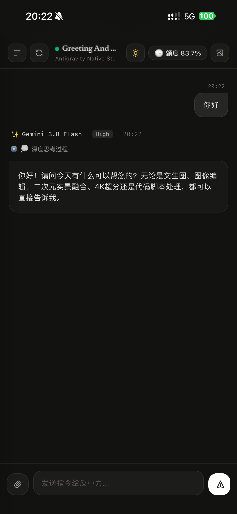

<p align="right">
  <a href="README.md">中文说明</a> | <b>English</b>
</p>

# Antigravity Remote Studio

Antigravity Remote Studio is a lightweight mobile web companion designed specifically for the **Google Antigravity Desktop Client**. It enables you to monitor real-time thinking processes, dispatch prompts, track model quotas, and browse locally generated image assets directly from your mobile or tablet browser.

<p align="center">
  
</p>

---

## Key Features

- **Real-Time Thinking Stream & Chat**: Synchronizes the model's internal reasoning chain (with collapsible panels and step timers) alongside full output streaming, with immediate support for follow-up prompts.
- **Non-Invasive Local Ingestion**: Reads Antigravity Desktop logs and underlying RPC endpoints directly. No special flags (like `--remote-debugging-port`) or app restarts required.
- **Model Quota Monitoring**: Displays live remaining quota percentages and reset countdowns for Gemini, Claude, and related model groups.  
  > ⚠️ **Note**: Mobile currently supports quota monitoring only. **Switching active models or adjusting thinking effort is not supported on mobile** (please configure models and effort levels in the Antigravity Desktop app).
- **Session Management**: Browse conversation history and resume previous chats with a single tap.
- **Image Gallery & Cinema Lightbox**: Aggregates locally produced image assets with full support for the [comfy2antigravity](https://github.com/Ekzykesax/comfy2antigravity) asset structure (`ComfyUI生图成果/`). Includes a full-screen lightbox supporting double-tap zoom, pinch-to-zoom, and press-and-hold saving.
- **Adaptive Network & Access Security**:
  - **LAN Direct Access**: Visits originating from the same Wi-Fi or loopback (`localhost` / `192.168.x.x`) bypass authentication entirely for effortless access.
  - **Remote Tunnel Access**: When accessed via cloud server SSH/FRP tunnels or Pinggy, master password setup and browser fingerprint verification are automatically enforced.
- **Task Completion Notifications**: Integrates with Bark, ServerChan, or PushPlus to alert your phone when long-running agent tasks complete or require attention.

---

## Architecture

```text
       ┌────────────────────────────────────────────────────────┐
       │                 Local Host (Computer)                  │
       │                                                        │
       │  ┌──────────────────────┐    ┌──────────────────────┐  │
       │  │ Antigravity Desktop  │    │ language_server.exe  │  │
       │  └──────────┬───────────┘    └──────────▲───────────┘  │
       │             │ Log Stream                 │ RPC Query    │
       │             ▼                           │              │
       │  ┌──────────────────────┐    ┌──────────┴───────────┐  │
       │  │ transcript.jsonl     │───►│ Antigravity Remote   │  │
       │  │ summaries.db / Brain │    │ Studio (Gateway)     │  │
       │  └──────────────────────┘    └──────────┬───────────┘  │
       └─────────────────────────────────────────┼──────────────┘
                                                 │
                   ┌─────────────────────────────┴────────────────────────────┐
                   ▼                                                          ▼
        [Cloud Relay / Tunnel]                                     [LAN Direct Connection]
        VPS Relay (SSH / FRP) or Pinggy Tunnel                     Same Local Wi-Fi Network
        (Enforces password verification)                           (Password-free instant access)
                   │                                                          │
                   └─────────────────────────────┬────────────────────────────┘
                                                 ▼
                                     ┌──────────────────────┐
                                     │ Mobile Browser / PWA │
                                     │ (iOS / Android Web)  │
                                     └──────────────────────┘
```

---

## Quick Start

### 1. Launch Service (Windows)

Run the launch script in the project directory:
```bat
start_remote.bat
```
*(For Linux / macOS users, run `./start_remote.sh`)*

The terminal will self-check dependencies and print the active local/tunnel access URL along with a terminal QR code.

### 2. Accessing from Mobile

- **LAN Direct Access**: Connect your phone to the same Wi-Fi network and open the printed LAN address (e.g., `http://192.168.x.x:8888`). No password required.
- **Remote Access (Outside Home)**:
  - **Cloud VPS Relay**: Configure your server IP in `config.json`. The gateway sets up reverse port forwarding via SSH or FRP automatically.
  - **Temporary Tunnel**: Set `network.mode` to `"tunnel"` in `config.json` to utilize Pinggy.  
  When accessing over the public internet for the first time, you will be prompted to set a master password. Once set, the same browser and IP retain password-free access automatically.

---

## Configuration (`config.json`)

If `config.json` does not exist upon initial run, it will be automatically created from `config.example.json`:

```json
{
  "server": {
    "host": "0.0.0.0",
    "port": 8888,
    "auth_token": "antigravity"
  },
  "network": {
    "mode": "tunnel",
    "tunnel_provider": "pinggy",
    "vps": {
      "host": "YOUR_SERVER_IP",
      "server_port": 7000,
      "remote_port": 8888,
      "token": "YOUR_CONNECTION_SECRET"
    }
  },
  "notifications": {
    "enabled": false,
    "bark_key": "",
    "pushplus_token": "",
    "serverchan_sendkey": ""
  },
  "workspace": {
    "root_dir": "",
    "gallery_subdirs": [
      "ComfyUI生图成果",
      "outputs",
      "output"
    ]
  },
  "auth": {
    "initialized": false,
    "password_hash": "",
    "salt": "",
    "session_ttl_days": 30
  }
}
```

> **Note**: `config.json` is listed in `.gitignore` to prevent private credentials from being pushed to public repositories.

---

## Cloud Server Setup (Optional)

To route traffic through your own fixed public IP, deploy the relay component on your server:

### Windows Server Relay
See the deployment script `deploy.ps1` in the [`server_deploy/windows/`](server_deploy/windows/) directory.

### Linux Server (Docker)
```bash
# Start FRP server
docker run -d --name antigravity_frps --restart always --network host \
  -v $(pwd)/frps.toml:/etc/frp/frps.toml fatedier/frps:v0.61.1 -c /etc/frp/frps.toml
```

For comprehensive instructions, refer to [`server_deploy/README.md`](server_deploy/README.md).

---

## Companion Image Generation Skill

If you run local AI image generation and editing pipelines in Antigravity, we recommend pairing this studio with the author's open-source skill:  
👉 **[comfy2antigravity (Universal ComfyUI Skill for AI Coding Agents)](https://github.com/Ekzykesax/comfy2antigravity)**

- **Seamless Asset Pipeline**: Encapsulates parameter-free text-to-image, high-fidelity image editing, 2D anime-real blending, and 4K bokeh-preserving upscaling via local ComfyUI, with outputs automatically organized into `ComfyUI生图成果/`.
- **Closed-Loop Mobile Interaction**: Rendered assets appear in real-time within this mobile gallery, allowing you to trigger prompts from your phone, render locally on your computer, and review/save high-resolution images on your mobile device.

---

## License

This project is licensed under the [MIT License](LICENSE).
